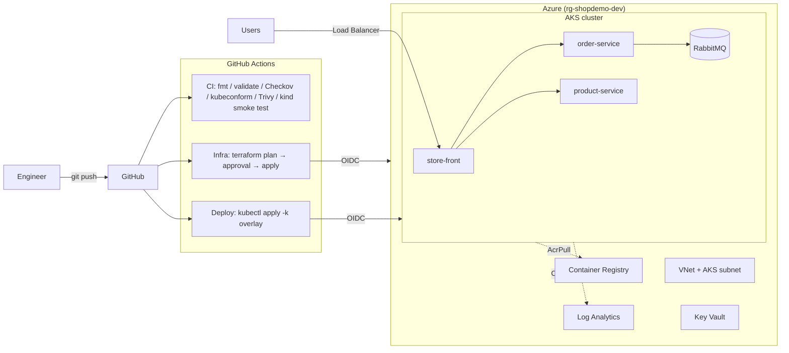

# Azure AKS Microservices Platform

Production-style platform for running a microservices application on **Azure Kubernetes Service**:
infrastructure as code, CI/CD pipelines with security scanning, environment overlays, autoscaling,
and passwordless (OIDC) deployments from GitHub Actions.

> **Problem this solves:** a team deploys by hand, environments drift apart, and nobody knows
> what is running in the cloud. This repo shows a repeatable setup where every piece of
> infrastructure and every deployment goes through code and a pipeline.

## Architecture



## What's inside

| Area | Implementation |
|---|---|
| **Infrastructure as Code** | Terraform (azurerm 4.x): Resource Group, VNet, AKS (Azure CNI Overlay, autoscaler, workload identity), ACR, Key Vault (RBAC), Log Analytics |
| **Remote state** | Azure Storage backend, bootstrap script included |
| **Microservices** | [AKS Store Demo](https://github.com/Azure-Samples/aks-store-demo): store-front, order-service, product-service, RabbitMQ |
| **Kubernetes config** | Kustomize base + `dev` / `prod` overlays, resource requests/limits, probes, HPA in prod |
| **CI** | Terraform fmt/validate, Checkov IaC scan, kubeconform schema validation, Trivy config + image scans, **end-to-end deploy test on a kind cluster** |
| **CD** | Manual, approval-gated Terraform and deploy workflows |
| **Security** | GitHub → Azure OIDC (no stored client secrets), AKS → ACR via managed identity, secrets kept out of git |
| **Observability** | Container Insights → Log Analytics |
| **Dev environment** | Dev container / GitHub Codespaces with Terraform, kubectl, Helm, kind, Azure CLI |

## Repository layout

```
.
├── terraform/              # Azure infrastructure
├── k8s/
│   ├── base/               # Microservice manifests
│   └── overlays/
│       ├── dev/            # 1 replica, ClusterIP
│       └── prod/           # 2+ replicas, HPA, public LoadBalancer
├── .github/workflows/
│   ├── ci.yml              # Runs on every push (free, no Azure needed)
│   ├── infra.yml           # terraform plan / apply / destroy (manual)
│   └── deploy.yml          # Deploy to AKS (manual)
├── scripts/
│   └── bootstrap-tfstate.sh
└── .devcontainer/          # Codespaces setup
```

## Run it without an Azure account (free)

Open the repo in **GitHub Codespaces** (Code → Codespaces → Create), then:

```bash
kind create cluster
kubectl apply -k k8s/overlays/dev
kubectl -n store-dev get pods -w
kubectl -n store-dev port-forward svc/store-front 8080:80
```

The CI pipeline does the same on every push, so a green build means the whole stack deploys and serves traffic.

## Deploy to Azure

1. **Remote state:** `./scripts/bootstrap-tfstate.sh`
2. **OIDC identity:** create an Entra ID app registration with a federated credential for this repo
   (`environment: azure`) and grant it *Contributor* + *User Access Administrator* on the subscription
   (the latter is needed for the AcrPull / Network Contributor role assignments).
3. **GitHub settings:**
   - Secrets: `AZURE_CLIENT_ID`, `AZURE_TENANT_ID`, `AZURE_SUBSCRIPTION_ID`, `RABBITMQ_USERNAME`, `RABBITMQ_PASSWORD`
   - Variables: `TFSTATE_RESOURCE_GROUP`, `TFSTATE_STORAGE_ACCOUNT`, `AKS_RESOURCE_GROUP`, `AKS_CLUSTER_NAME`
   - Environment `azure` with a required reviewer (approval gate)
4. Run **Infra (Terraform)** → `plan`, then `apply`
5. Run **Deploy to AKS** → `prod`, then open the `store-front` external IP
6. When finished: **Infra (Terraform)** → `destroy`

### Cost

With one `Standard_B2s` node and the Free AKS tier, the stack costs roughly **USD 1–2 per day**.
Destroy it when you're not using it.

## Roadmap

- [x] Terraform: network, AKS, ACR, Key Vault, Log Analytics
- [x] Microservices on Kubernetes with dev/prod overlays
- [x] CI with IaC/security scans and kind smoke test
- [x] OIDC-based infra and deploy pipelines
- [ ] Prometheus + Grafana dashboards and alerts
- [ ] GitOps with Argo CD
- [ ] Secrets from Key Vault through the CSI driver + workload identity
- [ ] Ingress controller with TLS (cert-manager)
- [ ] Same pipelines in Azure DevOps
